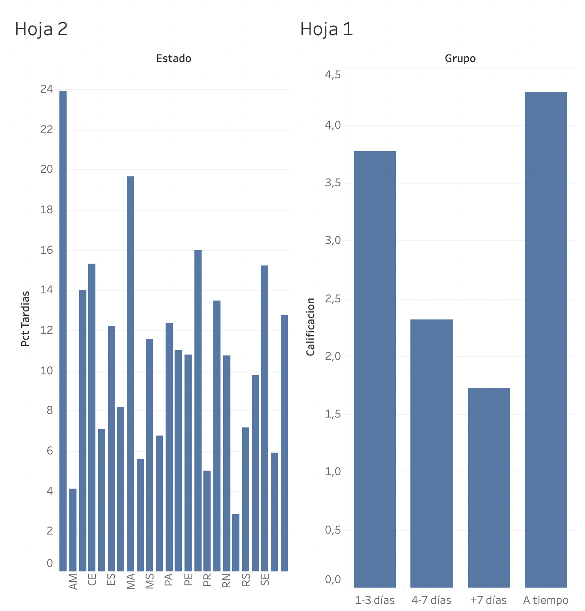

# Olist: impacto de los retrasos en la entrega

**[Ver dashboard interactivo en Tableau Public](https://public.tableau.com/views/Dashboard1_17944698447920/Dashboard1)**

Análisis de ~100 mil órdenes reales de un marketplace brasileño (Olist) para responder:
**¿los retrasos en entrega afectan las calificaciones y cuánto dinero está en juego?**

**Herramientas:** Python (pandas, matplotlib), SQL (SQLite), Tableau Public

## Resultados

- **8.11% de las órdenes llegan tarde** (7,826 de 96,470 entregadas).
- **La calificación cae con el retraso:** 4.29 a tiempo, 3.77 con 1-3 días, 2.32 con 4-7 días y 1.73 con más de 7 días.
- **Los retrasos se concentran en el noreste:** Alagoas (23.9%), Maranhão (19.7%), Piauí (16.0%) y Ceará (15.3%), contra 5.9% en São Paulo.
- **Río de Janeiro** es el caso con más impacto por volumen: 12,350 órdenes y 13.5% de retrasos.
- **Dinero en riesgo:** las entregas tardías son solo el 8.6% del ingreso, pero el 56.9% de ese ingreso termina con calificación de 1-2 estrellas (contra 11.0% en entregas a tiempo). Explican cerca de un tercio de todo el ingreso con mala calificación.

## Recomendaciones

1. Priorizar mejoras logísticas en Río de Janeiro (mayor impacto por volumen) y en el noreste (mayor tasa de retraso).
2. Ajustar las fechas estimadas de entrega en los estados con más retrasos para fijar expectativas realistas.
3. Contactar de forma proactiva a clientes con retrasos mayores a 3 días, donde la calificación cae por debajo de 3.

## Notas

- Solo se incluyen órdenes con estatus "delivered". Los estados con menos de 100 órdenes se excluyeron del análisis por estado.
- Las órdenes tardías del análisis de ingresos son 7,661 (y no 7,826) porque solo cuentan las que tienen reseña e ingreso registrado.
- Los resultados muestran asociación, no causalidad.

## Estructura del proyecto

- `sql/`: consultas de análisis (retrasos, calificaciones, estados, ingresos en riesgo).
- `notebooks/`: análisis y gráficas en Python.
- `dashboard/`: datos exportados y captura del dashboard.
- `load_data.py`: carga los CSV a SQLite.

##